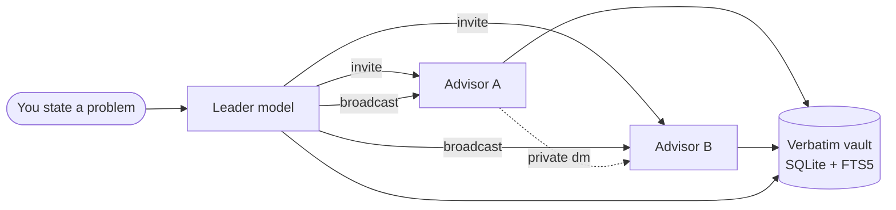

# Selected engineering work

Systems designed and built end to end — a native desktop AI orchestrator, an
honest quantitative research harness, and a privacy-first analytics terminal.

Each project here is **self-contained**: its own stack, its own test suite, its
own documentation, its own release path. They share a repository, not a
codebase. Nothing is a demo — every claim below is backed by a test run you can
repeat yourself.

[](https://dart.dev)
[](https://flutter.dev)
[](https://python.org)
[](https://fastapi.tiangolo.com)
[](#verification)
[](https://github.com/vajithhusan-eng/workshop/actions/workflows/test.yml)

---

## Projects

### [Agora](projects/agora/) — a multi-AI council on your own desktop

Flutter desktop application that drives **real Chrome** over the Chrome DevTools
Protocol. You state a problem once; a leader model decomposes it and invites
other models into a structured debate that runs until the leader declares it
solved — and **every word is stored verbatim**, with raw text, raw HTML and a
screenshot, so no output can be quietly paraphrased.



| | |
|---|---|
| **Why it is hard** | Browser automation against sites that actively change. Selectors live in versioned JSON, not code, so a site redesign is a config update — never an app release. |
| **Guarantees** | No server, no cloud, no API keys, no telemetry. Strict machine-readable dispatch blocks: free text can never trigger an action. |
| **Verified** | `flutter test` — 290 passing · `dart analyze` — 0 issues · 5-file C++ runner lint clean · ships as a 12 MB AppImage **and** a portable tarball |
| **Built with** | Dart 3.13 · Flutter 3.47 · raw CDP over WebSocket · SQLite via drift (schema v3, FTS5) |

→ **[Read the full write-up](projects/agora/README.md)**

### [RGX](projects/rgx/) — a research harness that can say "no"

A quantitative research harness built to be **honest before it is profitable**.
Its centrepiece is an invariant most backtests fail: *under a zero-edge null,
the pipeline must return no edge.* If it ever reports one, the harness is lying
and every result it produced is void.

Point-in-time universe → price/volume factors → microstructure regime gate →
LambdaRank ranker → cost-aware portfolio → honest evaluation (purged
walk-forward/CPCV, base-rate baselines, Newey-West t-stats, Deflated Sharpe,
PBO, trial-count deflation, and a random-signal null).

| | |
|---|---|
| **The honest result** | On synthetic data with a *planted* edge the harness reports `NO RELIABLE EDGE`. That is the point. |
| **Verified** | 47 invariant tests, plus 6 null-control tests that exercise the central claim (`RGX_SLOW=1`) — 53 passing |
| **Built with** | Python · pandas · scikit-learn · GBDT ranking · purged cross-validation |

→ **[Read the full write-up](projects/rgx/README.md)** · *[Locked methodology](projects/rgx/AGENTS.md)*

### [OMNIVEST](backend/) — education, not advice

A finance terminal with a deliberate design constraint: it is built to
**refuse** to give advice. System-level guardrails run in safe mode by default —
trading calls, ratings, price targets and "guaranteed" language are blocked
before they can reach a user, and the API reports its own mode honestly.

[](backend/)
[](frontend/)
[](backend/)

- **[`backend/`](backend/)** — Python + FastAPI, no database server: the journal is a JSON file on disk. 143 unit checks and 168 live API checks.
- **[`frontend/`](frontend/)** — Flutter web, five tabs ordered by what the user actually needs (*why should I trust this at all?* comes first). 165 tests.

### [CleanTube](projects/cleantube/) — the ad blocker that doesn't block

An Android-first study whose insight is that you do not need to *block* YouTube
ads, you need to **not ask for them**: the web InnerTube client never requests
ad context, so there is nothing to strip.

**Honestly stated:** design and research only, no code yet, and its first
milestone is a feasibility gate explicitly designed to be able to kill the
project. It has not been run.

→ **[Read the design](projects/cleantube/README.md)**

---

## How this is built

The parts that are not visible in a screenshot, and are the reason the claims
above can be trusted:

- **One document standard, enforced by a checker.** Every project carries the
  same document set — `README.md`, `AGENTS.md`, `STATE.md`, `CHANGELOG.md`,
  `docs/README.md` — and `make projects-check` fails the build if any is
  missing or malformed. [`PROJECT-STANDARD.md`](PROJECT-STANDARD.md) is the
  contract; [`scripts/verify_projects.py`](scripts/verify_projects.py) enforces
  it. New projects are stamped from `templates/project/` by
  [`scripts/new_project.py`](scripts/new_project.py).
- **State is derived, never asserted.** Every project's `STATE.md` carries the
  exact commit it was verified against and the exact commands that produced the
  numbers. `make docs-check` fails when a pin no longer matches HEAD, so a
  stale status cannot survive.
- **Documentation states what is missing.** Every README has a *known limits*
  section. Agora's lists the features that are deliberately not built; RGX's
  reports that it finds no edge. Gaps are recorded, not papered over.
- **CI gates what can be gated.** `verify_projects.py` runs hard; the pin check
  runs advisory, because a pin is a working-tree fact.
- **Commits** follow `<type>(<scope>): <description>`.

## Verification

Every command below is real, runnable, and was used to write this page.

```bash
# Agora — Flutter desktop
cd projects/agora && flutter test        # 290 passing, 1 intentional skip
cd projects/agora && dart analyze        # 0 errors, 0 warnings, 0 info
cd projects/agora && ./tool/cpp_lint.sh  # native runner: 5 files, 0 warnings

# RGX — quant research
cd projects/rgx && .venv/bin/python -m pytest tests/                    # 47 passing
cd projects/rgx && RGX_SLOW=1 .venv/bin/python -m pytest tests/         # 53 passing

# OMNIVEST
cd backend  && python -m app.tests.test_units    # 143 checks
cd frontend && flutter test                      # 165 passing

# The documentation standard
make check   # every project has its files; every STATE.md pin matches HEAD
```

## Layout

```
projects/agora/       Flutter desktop · AI council over CDP · AppImage
projects/rgx/         Python · quantitative research harness
projects/cleantube/   Flutter Android · plan + research, no code yet
backend/              Python/FastAPI · OMNIVEST API
frontend/             Flutter web · OMNIVEST terminal
scripts/              the document-standard tooling
templates/project/    the canonical project skeleton
PROJECT-STANDARD.md   the contract every project follows
```

---

**Vajith Husan** · [GitHub](https://github.com/vajithhusan-eng) · vajithhusan2510@gmail.com
